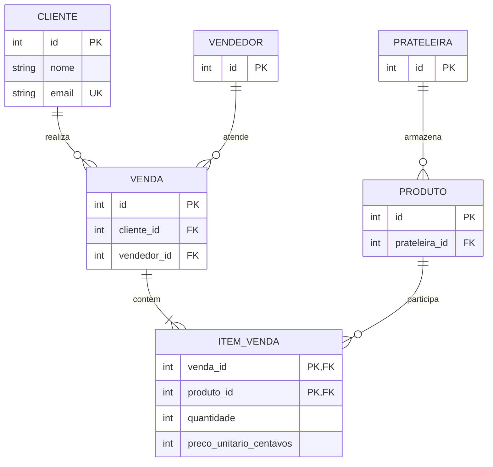

# Mapa das aulas da faculdade para o ERP by Isaac

Este documento relaciona os **23 arquivos PDF** que vieram no pacote `Dados da Faculdade.zip` aos exercícios de laboratório. Foi feita inspeção visual de slides; os PDFs contêm **páginas em imagem**, não texto selecionável. Os exercícios são implementações independentes dos assuntos estudados, **não reproduções literais de todos os exemplos e códigos dos slides**.

**Importante:** não publicamos os PDFs dos professores no GitHub. O material de apoio é um trabalho educacional separado, e os nomes dos arquivos aparecem apenas para permitir localização no acervo privado do estudante.

## Algoritmos e Linguagem de Programação — professor Ramon

| PDF | Conteúdo observado | Aplicação no projeto |
| --- | --- | --- |
| `1.pdf` | Anatomia de algoritmos, entrada, processamento, saída, fluxogramas e Portugol | Calculadora de soma e estudo do caminho dos dados |
| `2.pdf` | Variáveis, pseudocódigo, tipos e algoritmos sequenciais | Validação e conversão de campos numéricos |
| `3.pdf` | Estruturas de decisão, operadores lógicos e de repetição; `escolha...caso` | Classificador de triângulos; laços e parcelamento |
| `4.pdf` | Web, arquitetura cliente-servidor, HTML, CSS e interações básicas | Página HTML/CSS/JS local sem dependências |
| `5.pdf` | JavaScript moderno, variáveis, tipos, console e conversões | Funções `numero()` / `somar()` e inspeção de código |
| `6.pdf` | Tríade da Web, DOM, formulários, `alert`, `confirm`, `prompt` | Formulários dinâmicos com `addEventListener` e `textContent` |
| `7.pdf` | Construção de templates, interface semântica, CSS, eventos | Calculadora funcional com estilo responsivo |
| `8.pdf` | 5 aplicações práticas: idade, moeda, temperatura, imposto e juros | Calculadora de idade e simulador de juros (módulos iniciais) |
| `9.pdf` | Decisões JS, operadores `&&`, `||`, `!`, triângulos e IMC | Classificador de triângulos e IMC (somente didático) |
| `10.pdf` | `if`, `else if`, condições encadeadas, reembolso/salário e manipulação do DOM | Validações de formulário e feedback de erros |
| `11.pdf` | `while`, `do...while`, `for`, incremento e simulação de parcelamento | Simulador de parcelamento, com valores em centavos |
| `12.pdf` | Tabuada dinâmica, tabelas HTML e repetição | Tabuada de 1 a 10 gerada por laço |
| `13.pdf` | Arrays, índices, `push`, `pop`, `shift`, `unshift`, ordenação | Editor e estatísticas de array |
| `14.pdf` | Funções, parâmetros, retorno, escopo e validação | Funções puras em `logica.mjs`, testadas com Node |
| `15.pdf` | Construção de PDV online com arrays e funções; validação de quantidade | PDV fictício com carrinho, estoque, total e troco |
| `16.pdf` | Aplicação final de anotações com HTML/CSS/JS e `localStorage` | Notas locais com adicionar, editar, excluir e persistência opcional |

## Sistemas de Informação / Banco de Dados — professor Ramon Paixão

| PDF | Conteúdo observado | Aplicação no projeto |
| --- | --- | --- |
| `From_Data_to_Intelligence.pdf` | Evolução dos arquivos físicos, bancos relacionais, SGBD e dados na IA | Contexto histórico para compreender por que usar tabelas |
| `SGBD_Blueprints.pdf` | Arquitetura de SGBD, independência de dados e papéis | Diferenciar aplicação Flask, SQL e camada de armazenamento |
| `Data_Abstraction_and_Modeling.pdf` | Modelos conceitual, lógico e físico; mapeamento de entidades para tabelas | Modelo de vendas representado por esquema SQL |
| `MER_Entities_and_Attributes.pdf` | Entidades fortes/fracas, atributos simples/compostos, identificadores | `cliente`, `vendedor`, `prateleira`, `produto`, `venda` |
| `MER_Relationships_and_Cardinality.pdf` | Relacionamentos, graus, cardinalidade mínima e máxima | Relações 1:N e N:N documentadas e testadas |
| `Blueprint_DER.pdf` | DER, notação gráfica e extensão de modelos | Diagrama abaixo mostrando as chaves e associações |
| `Relational_Data_Foundations.pdf` | Modelo relacional, chaves e integridade; atividade prática de sistema de vendas (p.18) | `04_modelagem_vendas.sql`, consultas `JOIN`, `GROUP BY`, `HAVING` |

### Exemplo de MER/DER lógico: sistema de vendas



**Por que `item_venda` existe?** Uma venda contém vários produtos, e um produto pode aparecer em muitas vendas. Isso é um relacionamento **muitos para muitos**, implementado como tabela associativa. O preço unitário fica registrado no item para preservar o preço praticado no dia, mesmo que o cadastro do produto seja atualizado depois.

### Rodando os exercícios

**Direto no navegador:** abra `static/laboratorio/index.html`. Pode ser por `file://` (navegadores modernos que aceitam módulos ES locais podem exigir um servidor HTTP); o modo mais compatível é rodar um servidor estático local:

```bash
python -m http.server 8000
# Abra http://127.0.0.1:8000/static/laboratorio/
```

Ou, depois de iniciar o ERP Flask, abra `http://127.0.0.1:5000/static/laboratorio/`.

**SQL em SQLite isolado, sem tocar no ERP:**

```bash
python exemplos/modelagem_vendas.py
python -m unittest discover -s tests -p 'test_modelagem_vendas.py' -v
```

**JavaScript (Node 20 ou superior):**

```bash
node --test static/laboratorio/testes.mjs
```

## O que está e não está incluso

- Inclui **9 exercícios interativos** (um deles é um pequeno PDV), script de DDL e DML de vendas, três consultas reais e testes.
- Os números, preços e nomes dos dados simulados são fictícios.
- Não executa SQL digitado livremente contra o banco do ERP; isso seria inseguro.
- Não copia os PDFs originais nem afirma reproduzir integralmente os 314 slides.
- Os exercícios podem ser alterados pelos colegas por commits e Pull Requests.
